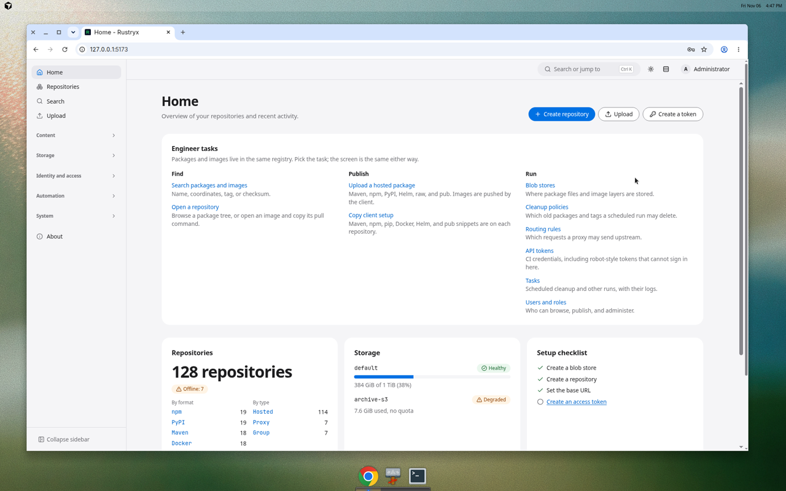
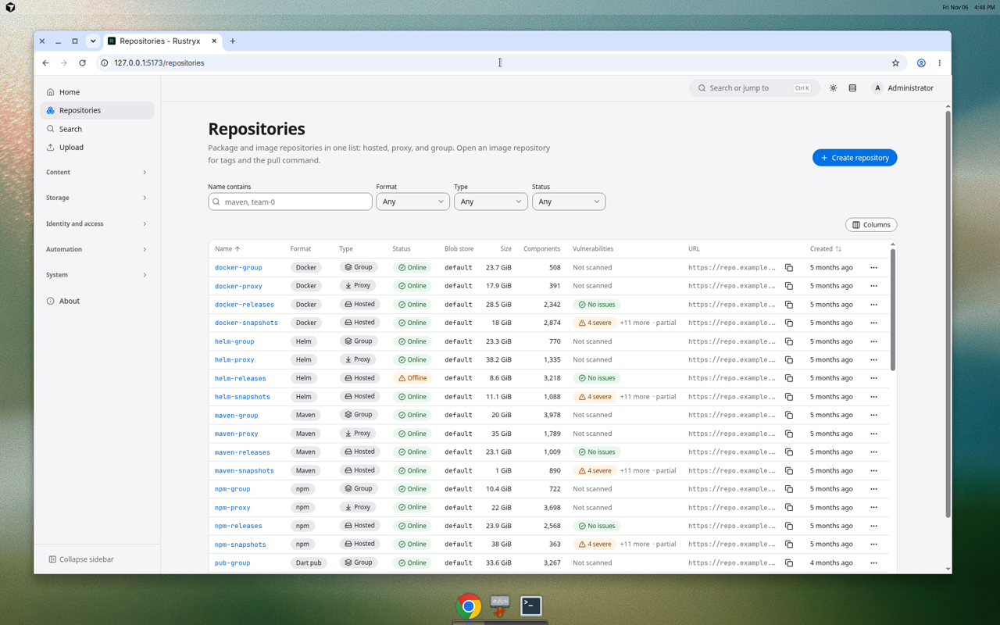
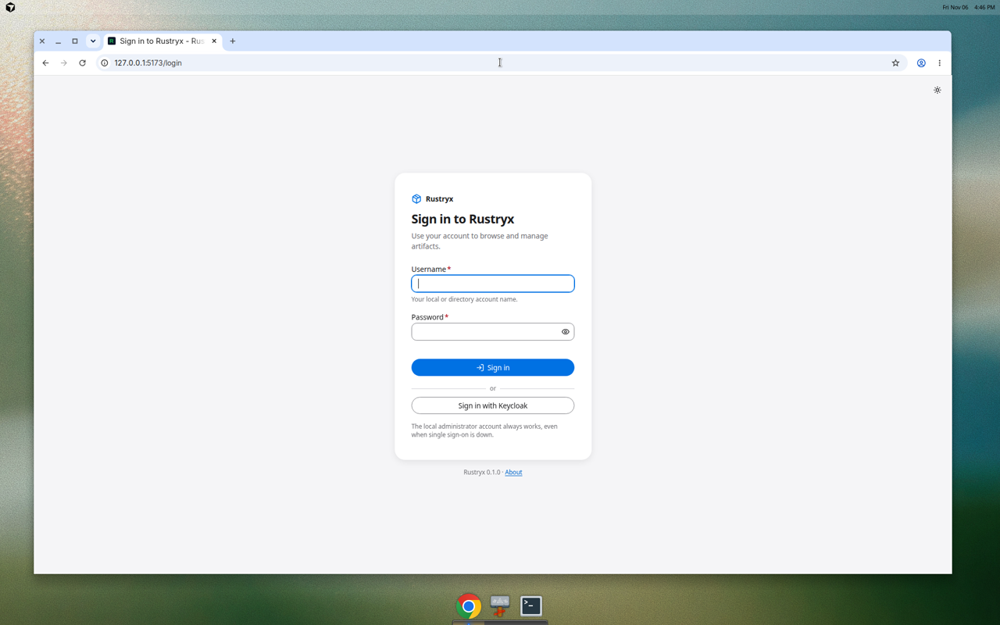

# Rustryx

A self-hosted artifact manager for teams that want their packages, images and
charts on infrastructure they run. One Rust service stores the bytes, answers
the package clients you already use, and keeps the metadata in PostgreSQL.



Hosted, proxy and group repositories for maven2, npm, PyPI, Docker and OCI,
Helm, raw files, and Pub (Dart and Flutter). Sign-in is local, or through
Keycloak (OIDC) and LDAP, with roles taken from groups. Nodes are stateless:
scale them out, put a load balancer in front, and keep blobs on local disk or
on any S3 API. The local stack uses [SeaweedFS](https://github.com/seaweedfs/seaweedfs).

License: MIT. The implementation is clean-room. It follows public protocol
specifications and the public compat v1 REST API contract, not the source,
schema or documentation of any other artifact manager.

Status: under construction (phase 1). The web UI below is the mock build, filled
with the same fixture data the unit tests use, so you can click through the
product before a database is running.

## What you can do with it

* Publish and proxy Maven, npm, PyPI, OCI (Docker and Helm), raw files and Pub.
* Group several repositories behind one URL and keep a hosted copy next to a proxy.
* Sign in with a local account, Keycloak or LDAP. Map groups to roles.
* Store blobs on disk or on S3. SeaweedFS, Ceph RGW and AWS S3 all speak that API.
* Stream uploads and downloads. A node does not hold a whole artifact in memory.
* Call a compat v1 REST API where existing CI clients already speak it.



## Try the interface

The UI is a React application. The mock mode needs Node 22 and no backend.

```
cd ui
npm ci
npm run mock
```

Open <http://127.0.0.1:5173/login>. The mock password for every fixture account
is `mock-password` (for example user `admin` or `alice`). That password exists
only in the browser mock. It is not a credential of a running server.



A production build of the same UI is embedded in the `rustryx` binary. The
`ui` job in CI typechecks, lints and tests it.

## Run the services

PostgreSQL 16, Redis 7, SeaweedFS, Keycloak and OpenLDAP, all bound to
`127.0.0.1`, with public test passwords:

```
cd deploy/compose
docker compose up -d
docker compose ps
```

`seaweedfs-init` and `certs` exit 0 after they finish. That is success.
SeaweedFS S3 is `http://127.0.0.1:8333` (bucket `rustryx-blobs`, key
`rustryx-seaweed`, secret `seaweed-test-only-secret`). The filer UI is
`http://127.0.0.1:8888`. Details, including every test password, are in
[docs/local-development.md](docs/local-development.md).

```
docker compose --profile rustryx up --build   # also build and run rustryx
docker compose down -v                        # stop and delete the data
```

The server listens on <http://127.0.0.1:8081>. The bootstrap administrator is
`admin` / `admin-test-only-0123456789`. Do not reuse any of these values
outside a developer machine, and do not publish the compose ports.

## Credentials in this repository

There is no production key, cloud token or private signing key in the tree.
What you will find, on purpose:

* `deploy/compose/.env.example` and the Keycloak realm: passwords and client
  secrets whose names end in `test-only` or `TEST-ONLY`. They are fixtures.
* `ci/cosign.pub`: a public verification key, not a private key.
* PEM blocks inside tests and the OpenAPI examples: short stand-ins
  (`AAAA`, `...`), not real keys.

Create `deploy/compose/.env` (git-ignored) when a local value must differ.
Never commit a real secret. The supply-chain rules are in
[docs/supply-chain.md](docs/supply-chain.md).

## Workspace

| Crate | Purpose |
|---|---|
| `rustryx-core` | domain types, ports (traits), errors |
| `rustryx-config` | configuration loading and validation |
| `rustryx-observability` | tracing, metrics, OTLP |
| `rustryx-db` | PostgreSQL: migrations and port implementations |
| `rustryx-blob` | local disk and S3 blob stores |
| `rustryx-auth` | local, API token, OIDC and LDAP authentication, group resolution |
| `rustryx-rbac` | privileges, roles, content selectors, authorization |
| `rustryx-format-core` | shared hosted, proxy and group pipeline |
| `rustryx-format-{maven,npm,pypi,oci,helm,raw,pub}` | one crate per package format |
| `rustryx-api` | axum router, middleware, compat v1 REST API |
| `rustryx-tasks` | scheduler and background jobs |
| `rustryx-server` | the `rustryx` binary (`serve`, `migrate`) |
| `rustryx-testkit` | in-memory ports and fixtures for tests |
| `ui` | the web UI embedded by the server |

## Source

* GitHub: <https://github.com/xakrume/rustryx>
* GitLab: <https://gitlab.xakru.me/rustryx/rustryx> (group `rustryx`)

GitLab runs the full check list in `.gitlab-ci.yml` on merge requests, the
default branch, and version tags. The job table is in
[docs/ci-and-release.md](docs/ci-and-release.md).

## More documentation

| Guide | What it covers |
|---|---|
| [docs/local-development.md](docs/local-development.md) | compose stack, fixtures, TLS |
| [docs/config.md](docs/config.md) | every configuration key |
| [docs/blob.md](docs/blob.md) | local and S3 blob stores, SeaweedFS test |
| [docs/ci-and-release.md](docs/ci-and-release.md) | GitHub Actions and GitLab CI |
| [docs/ui-architecture.md](docs/ui-architecture.md) | how the web UI is built |
| [CONTRIBUTING.md](CONTRIBUTING.md) | workspace rules for a change |
